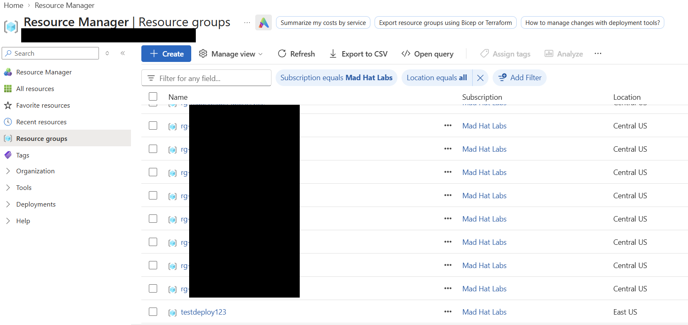
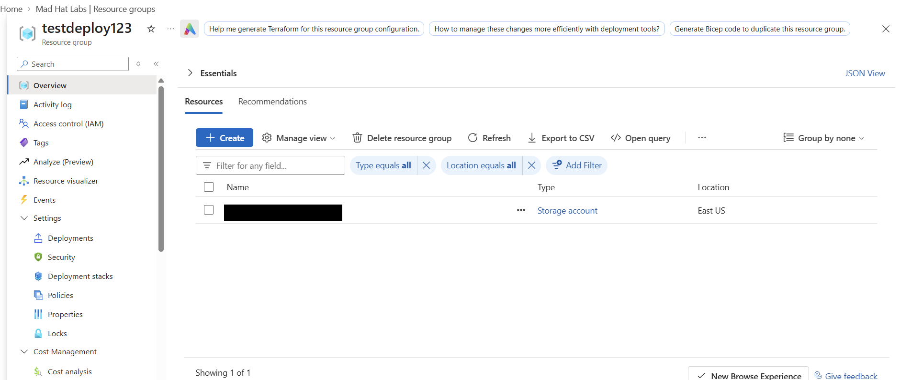
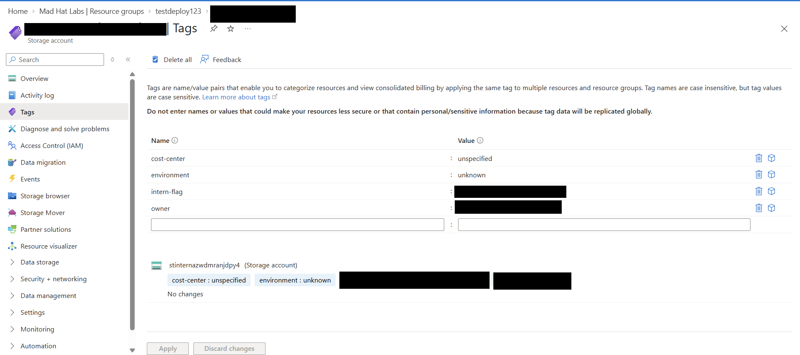
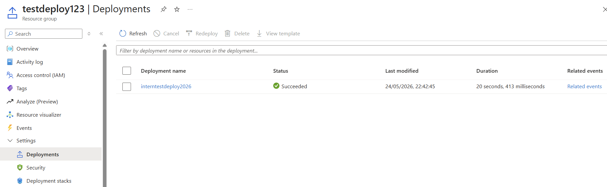
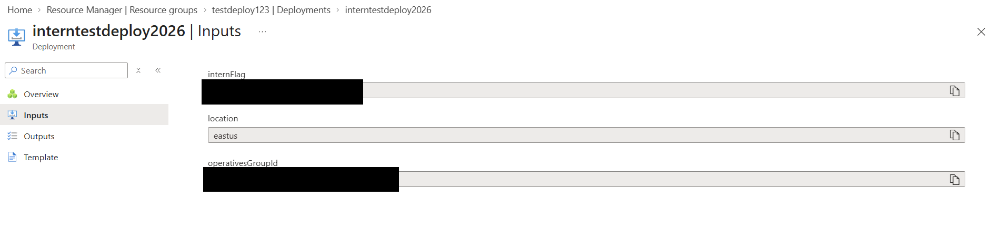
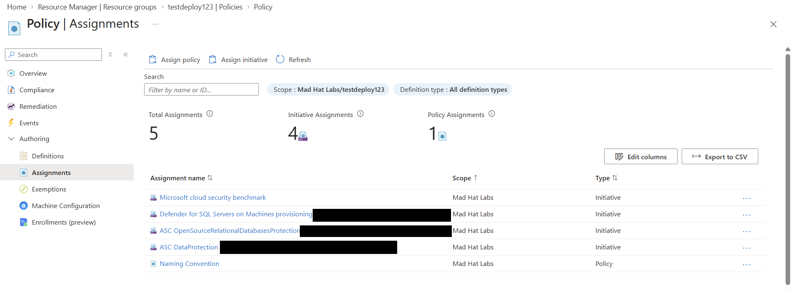
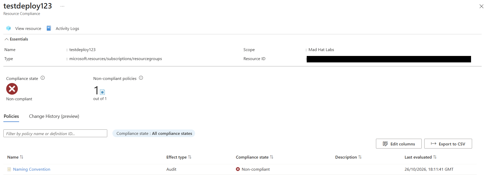

# Opeation Dead Deploy
Investigating a unusually named resource group 

## Scenario
An intern with temporary Contributor access deployed a "test environment" using a shortcut before leaving. An investigation was conducted to reconstruct the deployment and understand why a non-compliant resource group had been created.

## Environment
Live multi-user Azure training tenant with Reader access

## Investigation

### Stage 1: Identify the non-compilant resource group
 Under our designated subscription while scanning the resource groups, i identified a resource group that didn't follow the established naming convention. The resource group name was: **testdeploy123**, which was inconsistent with the naming format used by other resource groups in the subscription.

### Stage 2: Inspect the payload
 Under **testdeploy123** resource group, only one resource was found. I found Several tags under this resource: owner, cost-center and intern-flag and environment. These tags suggested that this resource was associated with an intern.

### Stage 3: Trace the deployment
Every azure resource is created by an IaC deployment. I examined the creation story, under this(**testdeploy123**) resource group's deployment blade. I found one deployment named **interntestdeploy2026** with status "Succeeded". The deployment start time: *24/05/2026, 22:42:25*. I then examined the deployment's input parameters, which provided further context about the deployment. The deployment name and parameters suggested that it was associated with an intern, consistent with the tags identified earlier.

### Stage 4: Examine the policy
A naming policy existed on the subscription and was active, yet the resource got created anyway. The **Effect** parameter was set to **Audit**, which logs violations, instead of **Deny**, which blocks them. This explained why the resource group had been created despite not meeting the naming requirements.

## What surprised me
Navigating the live azure environment and understanding its different components, including subscriptions, resource groups, resource, deployments, tags and policies took some time. However, this process helped me understand hierarcy, infrastructure and how resources are organised in the environment. I was surprised by how much information could be gathered from relatively simple checks. By examining resource tags, deployment history and policy configurations, I was able to reconstruct key details of the deployment and identify a possible reason for the naming violation. Initially, I assumed that there was no naming policy. However, after exploring the Policies section, I discovered that a naming policy was already in place. What surprised me most was that the resource group had been flagged as non-compliant, yet its creation had not been prevented. 

## Findings and recommendations

This non-compliant resource was the result of a legitimate deployment created without following compliant naming conventions, because the naming policy effect was not set to block the request if it was non-compliant. I recommend reviewing whether the Audit effect was intentional. If it requires strict enforcement of naming standards, the policy should be evaluated and tested before changing its effect to Deny.

## What I learned
- I would follow microsoft's or, the company's naming convention while naming any resources. It helps to identify and give context about the resource before opening, this simple practice will make work efficient for everyone.
- I would assign resource specific tags and correct flags for that resource during creation
- Azure deployment history and activity logs can provide useful evidence for reconstructing deployment timelines. When available, this information can be correlated with other logs and security alerts to build a clearer picture during an investigation.
- The effect assigned to an Azure policy determines how violations are handled. Understanding the difference between Audit and Deny is essential for implementing the intended governance controls and avoiding unexpected compliance outcomes.
