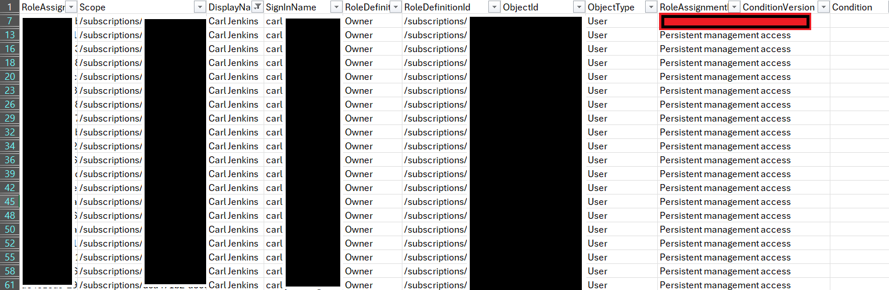
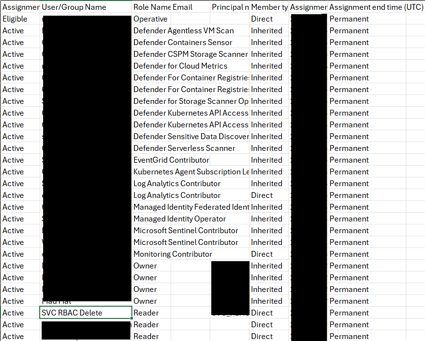
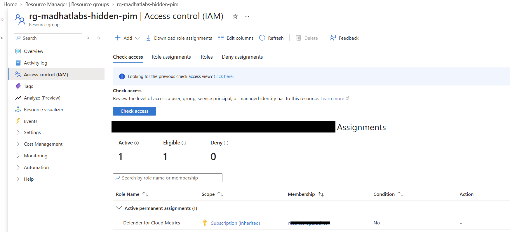
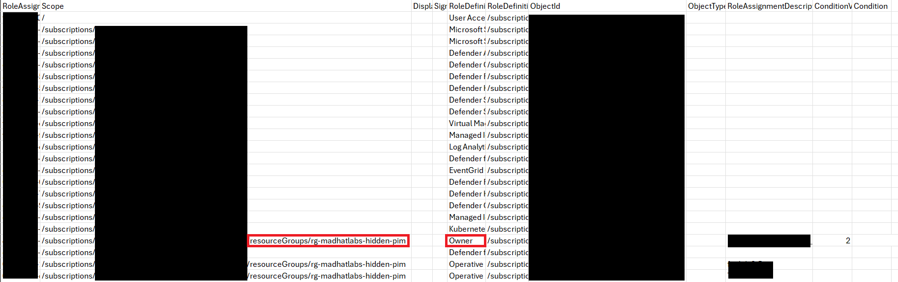

# Azure Role-Based Access Control Audit

## Scope and methodology

This audit reviewed Azure RBAC assignments within an live, multi-user Azure training tenant. The goal was to find out who had access to what resources and why. The assessment was conducted using Reader-level access along with a PIM-eligible role.

Tools used:
- Access Control (IAM) - Role Assignment Export
- Azure CLI - Role Assignment Enumeration
- Azure Resource Graph using KQL - Tenant wide query for analysing RBAC
- Privileged Identity Management (PIM) - Activate and analyse eligible assignments

### Finding 1: Single principle, Owner of multiple resources | IAM Blade
The audit started with inspecting IAM blade at different scope levels of this tenant. It is time-consuming to look into each role under each scope(subscription , resource group , resources). A **role assignment** csv file was supplied which was downloaded at subscription level by a privileged account. The role assignments report includes active permissions inside of an subscription and its resources. Analysing the report, an account was found with 'Owner' role across a number of resourses (subscription, resource groups).

Fig. 1

This audit method shows what role a group has at which scope, but members of the group can't be knoown. Hence, it can't be known whether an account has over provisioned access. This method might also miss **orphans** (accounts deleted but role assignment persists).

Quarterly check role assignments and IAM blade to identify anomally.
### Finding 2: Orphaned Account | Azure CLI
To get more information about role assignments at each scope, Azure CLI can be utilised. Although CLI output is restricted to auditor's account permission. In Azure portal, I opened the CLI and selected powershell and ran this command: 
"az role assignment list --resource-group ResourceGroupName"
A principalId was found with empty resource name, for production resource group. It is an **orphan account**, a role assignment linked to a deleted account. These redundant role assignments need to be deleted, if a new principal manages to get same objectId as the orphan account, it will inherit the existing permissions automatically, without needing provision and stay unnoticed. 
Similarly, this command can be repeated for other resource groups to find orphaned accounts which can be exploited.

Fig. 2

### Finding 3: Tenant-wide View for Role Assignments| Azure Resource Graph
With Azure Resource Graph we can audit the whole tenant with a single query whereas previous 2 methods allow to work with one scope at a time. It allows to query the raw **Azure Resource Manager database** across the entire tenant simultaneously. This allows to instantly sweep every subscription for compromised or orphaned access in a single KQL execution. On azure portal, opening **Resource Graph Explorer** I queried the authorizationresources table

Fig. 3

This KQL command can be further modified to the privileged roles, find the same principal assigned redundantly across multiple scopes, or list custom roles nobody is using.

### Finding 4: Forgot to Remove Temporary Role Assignment: Privileged Identity Management(PIM)
The above 3 methods only showed active assignments on resources, missing eligible to be active assignments. PIM shows whether role assignments are Active, Eligible, or Expired. Navigating to Privileged Identity Management(PIM) page, under Manage > Azure resources, specifying the subscription and resource group, I selected Manage resources. Then, going to Assignments, I exported an audit report. Now,we can see assignment state(eligible/active), user/group name under that resource group.

Fig. 4

Inside the export, I noticed a principal name in this resource group with a 'delete' label on it. This role wasn't inherited either, which further makes me think someone manually created this assignment for a temporary task, but forgot to remove it later.
### Finding 5- An Over-provisioned Account: Owner of a Hidden Resource group

While expoloring the PIM page, under My roles > Azure resources I found a hidden resource group which was eligible to activate.

Fig. 5

I activated the resource group and confirmed the activation through PIM's audit history.

Fig. 6

Fig. 7

Then, I went to activated resource group's IAM page and downloaded its role assignments. The role assignment file revealed an interesting details: owner of this resource group was the over provisioned account previously found in this audit.

Fig. 8

### Methodology Comparison

|               Method                    |                         Sees                         |               Misses               |
|-----------------------------------------|------------------------------------------------------|------------------------------------|
| IAM blade and role assignments export   | Active assignments at scope, inherited, children     | Group members, orphaned principals |
| Azure CLI                               | Same, plus null principalName (orphans)              | One scope per command              |
| Resource Graph (KQL)                    | Whole tenant in one query                            | Eligible assignments               |
| PIM export                              | Eligible and active, audit history of eligible roles | Assignments outside PIM            |

### Findings
**High Severity**
- Repeated Owner assignments applied across numerous scopes to a single identity.
- Owner permissions identified within a previously hidden resource group.
- Orphaned role assignments associated with deleted identities.
**Medium Severity**
- Direct user assignments rather than group-based role assignment strategy.
- Standing permissions that could be moved into PIM eligibility.
**Low Severity**
- Limited visibility into group membership through standard IAM exports.
- Visibility gaps caused by using a single audit method.

## Recommendations: 
- Revoke orphaned assignments. 
- Replace redundant Owner grants with the narrowest job-function role at the narrowest scope. 
- Move standing privileged access to PIM-eligible with MFA, justification, and time limits. 
- Assign to groups rather than users. 
- Run this audit on a quarterly cadence and treat the output as a ticket queue so it actually gets done.

## What broke / what surprised me
The most credible section in the document. Dead ends, wrong guesses, the thing that took an hour. Employers know real work is messy. This section separates you from certificate collectors.

## What I learned
3 to 5 bullets. At least one technical, one "what I'd do differently."

- 

The most important lesson from the Hunt was that no individual tool revealed the entire problem. Only by correlating IAM exports, CLI findings, Resource Graph results, PIM eligibility, and direct scope investigation could the full access picture be understood.