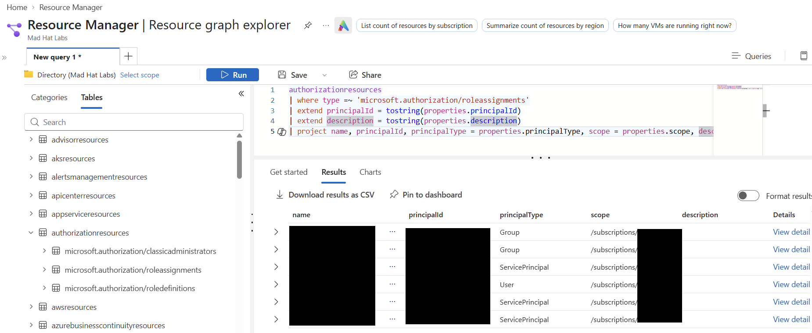
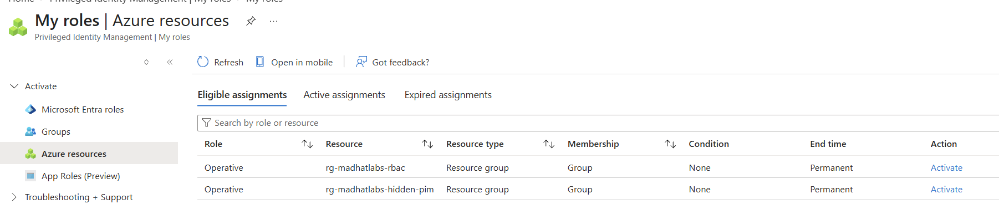

# Azure Role-Based Access Control Audit

## Scope and methodology

This audit reviewed Azure RBAC assignments within an live, multi-user Azure training tenant. The goal was to find out who had access to what resources and why. The assessment was conducted using Reader-level access along with a PIM-eligible role.

Tools used:
- Access Control (IAM) - Role Assignment Export
- Azure CLI - Role Assignment Enumeration
- Azure Resource Graph using KQL - Tenant wide query for analysing RBAC
- Privileged Identity Management (PIM) - Activate and analyse eligible assignments

### Finding 1: Single principle, Owner of multiple resources | IAM Blade

The audit started with inspecting IAM blade at different scope levels of this tenant. It is time-consuming to look into each role under each scope(subscription , resource group , resources). A **role assignment** csv file was supplied which was downloaded at subscription level by a privileged account. The role assignments report includes active permissions inside of an subscription and its resources. Analysing the report, an account was found with 'Owner' role across a number of resourses (subscription, resource groups).

Fig. 1

This audit method shows what role a group has at which scope, but members of the group can't be knoown. Hence, it can't be known whether an account has over provisioned access. This method might also miss **orphans** (accounts deleted but role assignment persists).

### Finding 2: Orphaned Account | Azure CLI

To get more information about role assignments at each scope, Azure CLI can be utilised. Although CLI output is restricted to auditor's account permission. In Azure portal, I opened the CLI and selected powershell and ran this command: 
"az role assignment list --resource-group ResourceGroupName"
A principalId was found with empty resource name, for production resource group. It is an **orphan account**, a role assignment linked to a deleted account. These redundant role assignments need to be deleted, if a new principal manages to get same objectId as the orphan account, it will inherit the existing permissions automatically, without needing provision and stay unnoticed. 
Similarly, this command can be repeated for other resource groups to find orphaned accounts which can be exploited.

Fig. 2

### Finding 3: Tenant-wide View for Role Assignments| Azure Resource Graph

With Azure Resource Graph we can audit the whole tenant with a single query whereas previous 2 methods allow to work with one scope at a time. It allows to query the raw **Azure Resource Manager database** across the entire tenant simultaneously. This allows to instantly sweep every subscription for compromised or orphaned access in a single KQL execution. On azure portal, opening **Resource Graph Explorer** I queried the authorizationresources table

Fig. 3

This KQL command can be further modified to the privileged roles, find the same principal assigned redundantly across multiple scopes, or list custom roles nobody is using.

### Finding 4: Forgot to Remove Temporary Role Assignment: Privileged Identity Management(PIM)

The above 3 methods only showed active assignments on resources, missing eligible to be active assignments. PIM shows whether role assignments are Active, Eligible, or Expired. Navigating to Privileged Identity Management(PIM) page, under Manage > Azure resources, specifying the subscription and resource group, I selected Manage resources. Then, going to Assignments, I exported an audit report. Now,we can see assignment state(eligible/active), user/group name under that resource group.

Fig. 4

Inside the export, I noticed a principal name in this resource group with a 'delete' label on it. This role wasn't inherited either, which further makes me think someone manually created this assignment for a temporary task, but forgot to remove it later.

### Finding 5- An Over-provisioned Account: Owner of a Hidden Resource group

While expoloring the PIM page, under My roles > Azure resources I found a hidden resource group which was eligible to activate.

Fig. 5

I activated the resource group and confirmed the activation through PIM's audit history.

Fig. 6

Fig. 7

Then, I went to activated resource group's IAM page and downloaded its role assignments. The role assignment file revealed an interesting details: owner of this resource group was the over provisioned account previously found in this audit.

Fig. 8

### Methodology Comparison

|               Method                    |                         Sees                         |               Misses               |
|-----------------------------------------|------------------------------------------------------|------------------------------------|
| IAM blade and role assignments export   | Active assignments at scope, inherited, children     | Group members, orphaned principals |
| Azure CLI                               | Same, plus null principalName (orphans)              | One scope per command              |
| Resource Graph (KQL)                    | Whole tenant in one query                            | Eligible assignments               |
| PIM export                              | Eligible and active access, audit history of eligible roles | Assignments outside PIM            |

### Findings
**High Severity**
- Single principle was holding privileged role for multiple resources
- An over-provisioned account was an owner of a resource group which was hidden under Privilege Identity Management’s eligible role.

**Medium Severity**
- A principal was deleted but role assignment linked to it, remained. Orphan accounts has potential to be exploited, they create confusions and take up spaces in azure resource manager database, potentially affecting role assignment limit, if there is any.
- A possible temporary role assignment was discovered, which was active at the time of audit. 

## Recommendations: 

- Revoke orphaned role assignments. 
- Move standing privileged access to PIM-eligible with MFA enforcement, justification, and time limited activation. 
- Assign to groups rather than users. 
- Role assignment should never be dependent only on one method. RBAC should be checked quarterly at different scope levels and using combination of methods: IAM blade, exporting role assignments, Azure CLI, KQL in Azure Resource Group, PIM reporting.
- Investigate every role assignment, follow least privilege access when assigning roles and revoke any unnecessary assignment. Scope down any over provisioned role, grant narrowest job-function role at the narrowest scope.
- For doing temporary jobs assign eligible role assignment in PIM. It will eliminate the opportunity of persistence and remove potential exploit opportunity if admin forgets to delete the account after job completion.
- Run this audit on a quarterly cadence and treat the output as a ticket queue so it actually gets done.

## What surprised me

Using KQL in Azure Resource graph allowed to query at any scope level which was efficient compared to using IAM and CLI for privilege audit. 
I was surprised to see that how different methods of auditing enabled me to look at role assignments from different angles, simulataneously each method had its limitations. Therefore, using those methods combinedly is essential to get a full picutre of the audit. At the last stage of this audit, I spent a few hours to understand the PIM's eligible role and match the owner of the hidden resource group's with previously found identity which was owner of multiple resources.

## What I learned

- Effective privilege audits require investigation at different scopes, combining a couple of methods including IAM export, CLI, KQL in Azure Resource graph. There is no one best method to do this audit.
- Role assignment can still exists even if the identity linked to it gets deleted, hence creates a vulnerability which can stay unnoticed if not investigated intentionally.
- Moving privileged access role to timebound PIM-eligible role, reduce the chance of potential exploitation.
- I would assign privileged access role to PIM-eligible instead of directly granting privileged access
