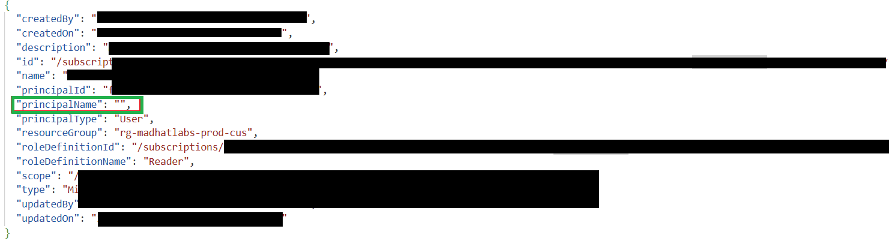
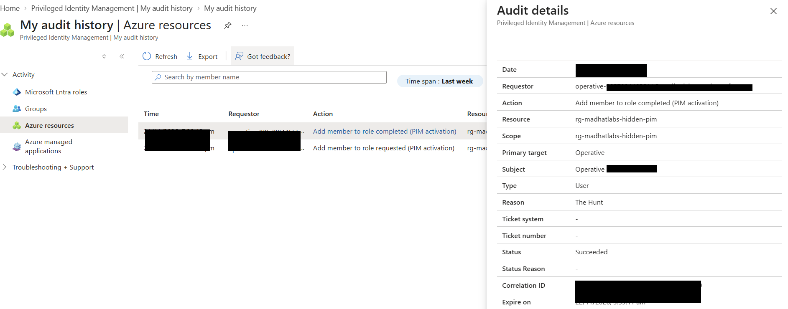

# Azure Role-Based Access Control (RBAC) Audit

## Executive summary

This audit reviewed Azure role-based access control (RBAC) assignments in a live, multi-user Azure training tenant to establish who had access to which resources and why. Four methods were combined: the IAM role assignment export, Azure CLI, Azure Resource Graph (KQL) and Privileged Identity Management (PIM). The audit identified two high-severity findings, two medium-severity findings and one methodology observation. The highest risk is a single account holding Owner access across multiple scopes, including a resource group that was only reachable through a PIM-eligible role.

## Scope and methodology

**Scope:** Azure RBAC role assignments at subscription, resource group and resource level in a live, multi-user training tenant.

**Access used:** Reader-level access plus a PIM-eligible role. A subscription-level role assignment export (CSV), downloaded by a privileged account, was also supplied for the audit.

**Tools:**

| Tool | Purpose |
|------|---------|
| Access control (IAM), role assignment export | Review active assignments at each scope |
| Azure CLI | Enumerate role assignments per resource group |
| Azure Resource Graph (KQL) | Query role assignments across the tenant in a single query |
| Privileged Identity Management (PIM) | Review and activate eligible assignments |


## Findings

### F1: Single principal holding Owner across multiple scopes

**Observation**
I began by inspecting the IAM blade at different scope levels. The supplied subscription-level role assignment export lists the active permissions within the subscription and its resources. Analysing the export, I found one account holding the Owner role across several scopes: the subscription and multiple resource groups.

**Evidence**
Fig. 1


<p align="center"><em>Fig. 1: Subscription role assignment export</em></p>

The IAM export shows which role a group holds at each scope, but not who is in the group. It therefore cannot show whether an individual member has excessive access. This method may also miss orphaned assignments (where the account has been deleted but the role assignment remains).

**Risk**
Owner grants full control of a resource, including the ability to assign roles to others. If this account is compromised, the impact extends to every scope where it holds Owner.

**Severity**
High

**Recommendation**
Review whether this account needs Owner at each scope. Apply least privilege by granting the narrowest job-function role at the narrowest scope and revoke any unnecessary assignments. Move any remaining standing privileged access to PIM-eligible assignments.

### F2: Orphaned role assignment in the production resource group

**Observation**
To get more detail at each scope, I used Azure CLI. Although CLI output is restricted to auditor's account permission. In the Azure portal, I opened Cloud Shell, selected PowerShell and ran:

```
az role assignment list --resource-group <ResourceGroupName>
```

In the production resource group, one assignment had a principalId with a blank principalName. This is an **orphaned role assignment**: the identity it was granted to has been deleted, but the assignment was never removed.


<p align="center"><em>Fig. 2: Orphaned assignment in CLI output</em></p>

**Risk**

- **Restored accounts regain access silently.** A deleted user stays in the Entra recycle bin for 30 days. If it is restored within that time, it keeps the same object ID, and every orphaned assignment applies to it again without being re-approved.
- **Noise in access reviews.** Unresolved entries make reviews slower and can hide assignments that matter.
- **Role assignment limit.** Orphaned assignments count towards each subscription's limit on role assignments.

**Severity**
Medium

**Recommendation**
Remove the orphaned assignment. Run the same command against each resource group to find any other orphaned assignments.

### F3: Tenant-wide view of role assignments (methodology observation)

**Observation**
The IAM export and CLI work one scope at a time. Azure Resource Graph lets me audit the whole tenant with a single query, because it queries the **Azure Resource Manager database** across the entire tenant at once. This makes it possible to check every subscription for compromised or orphaned access in a single KQL query. In the Azure portal, I opened **Resource Graph Explorer** and queried the `authorizationresources` table.


<p align="center"><em>Fig. 3: Resource Graph query on role assignments</em></p>

**Risk**
None identified. This entry documents an audit method rather than a security issue.

**Severity**
Informational

**Recommendation**
Extend the query to filter for privileged roles, find the same principal assigned redundantly across multiple scopes, or list custom roles that are not in use.

### F4: Possible leftover temporary role assignment

**Observation**
The first three methods only show active assignments and miss eligible ones. PIM shows whether each assignment is Active, Eligible or Expired. In PIM, I went to Manage > Azure resources, selected the subscription and resource group, and chose Manage resource. Under Assignments, I exported an audit report showing the assignment state (Eligible or Active) and the user or group name for that resource group.

In the export, one principal in this resource group carried a "delete" label, and its assignment was not inherited. My inference is that someone created this assignment manually for a temporary task and did not remove it afterwards. I have not confirmed this.


<p align="center"><em>Fig. 4: PIM assignments export</em></p>

**Risk**
A temporary assignment left in place gives persistent access that nobody is tracking, and could be exploited.

**Severity**
Medium. The assignment was active at the time of the audit.

**Recommendation**
Investigate the assignment and revoke it if it is no longer needed. For temporary tasks, use time-limited PIM-eligible assignments so that access does not persist after the task is complete.

### F5: Over-provisioned account owning a hidden resource group

**Observation**
While exploring PIM, under My roles > Azure resources, I found a hidden resource group on which I held an eligible role.

I activated the eligible role and confirmed the activation in PIM's audit history. I then opened the resource group's IAM page and downloaded its role assignments. The export showed that the Owner of this resource group was the same account identified in F1, which already held Owner access across multiple scopes.


<p align="center"><em>Fig. 5: Eligible role in PIM</em></p>


<p align="center"><em>Fig. 6: Activation in PIM audit history</em></p>


<p align="center"><em>Fig. 7: Downloading role assignments</em></p>


<p align="center"><em>Fig. 8: Resource group Owner assignment</em></p>

**Risk**
The account identified in F1 also owns a resource group that was hidden from the earlier review, so its total privileged access is wider than the first three methods showed.

**Severity**
High

**Recommendation**
As for F1: review and scope down this account's Owner access and move any remaining privileged access to PIM-eligible assignments.

## Methodology comparison

| Method | Sees | Misses |
|--------|------|--------|
| IAM blade and role assignment export | Active assignments at the selected scope, including inherited and child scopes | Group members, orphaned principals |
| Azure CLI | Same, plus a blank principalName (orphans) | One scope per command |
| Resource Graph (KQL) | The whole tenant in one query | Eligible assignments |
| PIM export | Eligible and active access, and the audit history of eligible roles | Assignments outside PIM |

## Summary of findings

| ID | Finding | Severity |
|----|---------|----------|
| F1 | Single principal holding Owner across multiple scopes | High |
| F5 | Over-provisioned account owning a hidden resource group | High |
| F2 | Orphaned role assignment in the production resource group | Medium |
| F4 | Possible leftover temporary role assignment | Medium |
| F3 | Tenant-wide view of role assignments | Informational |

## Recommendations

1. **Apply least privilege.** Investigate every role assignment and revoke any that are unnecessary. Scope down over-provisioned roles by granting the narrowest job-function role at the narrowest scope. (F1, F5)
2. **Move standing privileged access to PIM.** Make privileged roles PIM-eligible, with MFA enforcement, justification and time-limited activation. (F1, F5)
3. **Remove orphaned role assignments.** (F2)
4. **Use PIM-eligible assignments for temporary tasks**, so access does not persist if an admin forgets to remove it when the task is complete. (F4)
5. **Assign roles to groups rather than individual users.**
6. **Audit quarterly with more than one method.** Review RBAC at different scope levels using a combination of the IAM blade, role assignment exports, Azure CLI, KQL in Azure Resource Graph and PIM reporting. Track the output as a ticket queue so the actions get done.

## What surprised me

Using KQL in Azure Resource Graph let me query at any scope level, which was much more efficient than using the IAM blade and CLI for a privilege audit.

I was surprised by how each method let me look at role assignments from a different angle, while each also had its own limitations. Combining them was essential to get the full picture. In the last stage of the audit, I spent a few hours understanding PIM eligible roles and matching the owner of the hidden resource group with the identity I had already found holding Owner across multiple resources.

## What I learned

- An effective privilege audit needs investigation at different scopes, combining several methods such as the IAM export, CLI and KQL in Azure Resource Graph. There is no single best method.
- A role assignment can still exist after the identity linked to it has been deleted. This creates a vulnerability that can go unnoticed unless you look for it intentionally.
- Moving privileged roles to time-bound PIM-eligible assignments reduces the chance of exploitation. In future, I would make privileged roles PIM-eligible instead of granting them directly.
